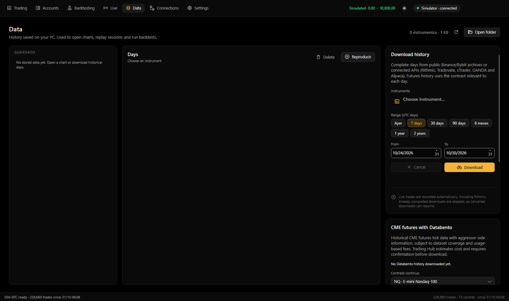

[← Back to documentation](README.md)

# Data

The **Data** section (Ctrl+3 on Windows or ⌘3 on macOS) manages locally recorded and downloaded history. This data can be reused instantly when opening charts, replaying sessions, and running backtests.

The screen shows **Saved** instruments on the left, available days in the center, and history downloads, Databento futures, and file imports on the right. The header includes the total instrument count and stored size, plus **Refresh** and **Open folder**.

> Screenshot inherited from the original project; labels may still appear in Spanish. The English fork is being translated in phases.

## Where historical data comes from

- **Record live data:** Incoming trades can be saved automatically, including Rithmic feeds. Controlled by **Settings → Data → Record live data**, enabled by default.
- **Downloads:** Whole trading days acquired from public exchange archives or supported broker APIs.
- **Imports:** CSV/TXT files containing ticks, bid/ask quotes, or candles.
- **Databento:** Paid-by-usage CME futures tick history.

Tick files are organized locally by connection, symbol, and UTC day.

## Saved data

Each saved instrument lists its connection, number of days, and disk usage. Selecting an instrument displays its days from newest to oldest and a size indicator for each day. The summary also shows the complete stored date range.

Use Ctrl or Shift (Windows), or Command or Shift (macOS), to select multiple days where supported.

### Delete stored days

1. Choose the instrument in **Saved**.
2. Select one or more days.
3. Select **Delete** and confirm.

Deleting saved days is irreversible unless you have separate backups.

## Replay

Replay reconstructs saved trading days as if they were live and allows simulated trading.

1. Select an instrument and one or more days.
2. Choose **Play** (or double-click a day).
3. Trading Hub opens a new chart tab marked ▶, starting at the earliest selected day's first trade and ending at the final selected day's last trade. The chart inherits the active chart's period and indicators, and earlier warm-up history is read from stored files where available.

| Control | Action |
|---|---|
| Play / Pause | Start or pause the replay |
| 1×–300× | Playback speed (1, 2, 5, 10, 30, 60, or 300 times real time) |
| Clock / Progress | Shows replay time and completion status |
| +5 min / +30 min / +1 h | Advance the replay |

Drawings added during replay are not saved; replay tabs are not included in the persistent workspace. Simulated trades are saved to the simulated account history.

## Download history

Downloads complete UTC days for the selected instrument.

1. Choose the **Instrument**; the active chart may preselect a supported one.
2. Choose a quick duration (Yesterday, 7/30/90 days, 6 months, 1 year, or 2 years), or set **From** and **To**. The current UTC day is excluded because it is not complete.
3. Review the date count and source summary.
4. Select **Download**. The screen displays progress, current day, and remaining work. **Cancel** stops further downloading.

| Source | Data acquired |
|---|---|
| Binance Futures / Spot | Public daily archives |
| Bybit | Public daily archives |
| Rithmic | Tick history for the relevant futures contract; expired-contract history may no longer be available from the API |
| Tradovate | Trade history where CME API data entitlement is present |
| cTrader | Broker bid quote ticks through Open API |
| OANDA | Five-second candles converted to synthetic trades |
| Alpaca | US equities ticks subject to account and data-feed entitlements |

Already completed days are skipped where possible; a cancelled job can resume from missing days. For API sources the app skips Saturdays and replaces incomplete local captures with a completed full-day download.

Futures instruments can exceed one million trades per day, so wide historical ranges may take considerable time. Empty days, holidays, unpublished archives, or expired contracts are reported separately. Connections lacking historical APIs still record what they receive live when recording is enabled.

## Import CSV or TXT

Import historical prices for CFDs, forex, metals, or instruments that are not available through a connection. Source files may come from Dukascopy, HistData, MetaTrader, TradingView, or other compatible exporters.

The importer detects common timestamp/price, bid/ask tick, and OHLC candle formats.

1. Acquire the source files. **Dukascopy** and **HistData** buttons open their download websites.
2. Set **Instrument name** (or leave blank to infer it from the filename).
3. Set **File time zone**:

   | Option | Typical source |
   |---|---|
   | UTC | Dukascopy or TradingView |
   | Fixed New York −5 | HistData |
   | UTC+2 | MetaTrader winter data |
   | UTC+3 | MetaTrader summer data |

4. Choose **Import files…** and select one or more CSV/TXT files.
5. Review the summary: imported trade count, day count, date range, and detected minimum price increment.

Imported symbols appear in **Saved** and become available for supported backtests.

Examples of symbol normalization: USATECH/NAS100/NDX/US100 map to US100; USA500/SPX/US500 to US500; USA30/US30/DJI to US30; DEU/GER/DAX to GER40; XAU/GOLD to XAUUSD. Common FX and metal symbols, such as EURUSD, GBPUSD, USDJPY, and XAGUSD, are also recognized.

**CFD limitation:** Quotes do not represent real exchange trades. Quote volume is modeled as one unit, aggressor direction is approximated from the change in price, and OHLC bars are converted into synthetic trades. Use these data for price studies, not as genuine footprint or delta evidence.

## Databento

Databento offers long-range tick-by-tick CME futures history, including aggressor-side data. It is billed by use; promotional credits may be available depending on the customer's account. Trading Hub calculates an estimate and requests confirmation before downloading.

First add a **Databento** connection with the API key in [Connections](conexiones.md#databento). The Databento card's **Connections** action opens that screen.

1. Choose a **Continuous contract** root, such as NQ, ES, MNQ, MES, YM, RTY, CL, GC, MCL, MGC, ZN, or 6E. The app uses volume-based contract rolls.
2. Set **From** and **To** dates (initially the most recent three months).
3. Choose whether to **Also download days already present in Rithmic**:
   - **Unchecked:** Skip completed days from Rithmic, reducing the number of Databento days purchased.
   - **Checked:** Download the full selected Databento range.
4. Select **Calculate cost**, then review the days, date range, and approximate USD charge.
5. Select **Download** and confirm the paid data request. Databento may charge the payment method on file for costs exceeding account credits.

Changing the instrument, date range, or skip-existing option invalidates the estimate; recalculate before downloading. Completed Databento days are normally not downloaded or charged again. Saturdays are skipped; the range ends at yesterday. **Cancel** stops new downloads while preserving completed days.

The same card lists downloaded Databento coverage for each instrument.

### Separate and combined data sources

Databento data are stored separately from Rithmic data. Backtesting may present the following selections, with stored day counts:

| Selection | Meaning |
|---|---|
| NQ · Rithmic + Databento | Prefer available Rithmic trades and fill periods with no Rithmic trades from Databento |
| NQ · Rithmic only | Use only saved Rithmic data |
| NQ · Databento | Use only Databento data |

Tradovate has an analogous combined/alone data-source choice. The backtest summary reports the contribution from each source.

**Avoid interpreting synthetic or merged tick data as an exact reconstruction of every exchange execution.** Verify provider coverage, missing days, contract rolls, and overlaps before relying on a backtest.

## Where files are stored

On macOS, the historical ticks live under `~/Library/Application Support/Trading Hub/Ticks`. On Windows, the corresponding location is `%APPDATA%\Trading Hub\Ticks`. The directory is organized by provider and instrument, with one file per UTC day. **Open folder** opens the local directory in Finder or File Explorer.

See [Installation](instalacion.md#where-data-is-stored).
