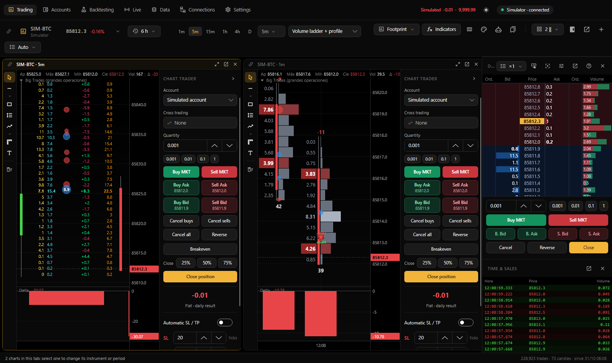

[← Back to documentation](README.md)

# Charts

Charts are managed from **Trading** (Ctrl+1 on Windows, ⌘1 on macOS). Each chart has drawing tools on the left and Chart Trader on the right. The top toolbar acts on the active chart.

## Chart toolbar

| Control | Description |
|---|---|
| Link color | Join charts in a shared color group; see [Link charts by color](#link-charts-by-color) |
| Instrument | Displays symbol, current price and session change; opens the instrument picker (Ctrl/⌘+K) |
| History | Select how much data to load |
| Period | Favorite timeframes and a selector with all supported bar types |
| Footprint template / Ticks per row | Shown in footprint mode |
| Chart type | Candles, OHLC bars, line, Heikin Ashi or footprint |
| Indicators | Opens the indicators manager (Ctrl/⌘+I) |
| Additional icons | Footprint editor, chart settings, chart strategies and templates |
| Layout | Number and arrangement of charts in a tab |
| Panels | Right-side Chart Trader, DOM, time and sales; DOM configuration |
| Detach and + | Move chart to another window or create a new tab |

On narrow screens the toolbar can wrap onto two rows.

## Instruments and history

The instrument picker searches enabled connections, with symbol, description, last price, 24-hour percentage change, and volume columns. Enter selects the active chart; Command/Ctrl+Enter opens a new tab where supported. Stars mark favorites.

The history menu offers approximately 30 minutes to five years, all available history, or a custom start date. Recent data loads tick by tick, supporting footprint. Older ranges may come from minute candles, with coarser aggregation for very long ranges, and therefore lack genuine tick-by-tick footprint detail. Ticks downloaded from [Data](datos.md) can be reused.

## Periods

Default toolbar favorites: 1 minute, 5 minutes, 15 minutes, 1 hour, 4 hours, and daily.

| Type | Available examples |
|---|---|
| Seconds | 5s, 10s, 15s, 30s |
| Minutes | 1m, 2m, 3m, 5m, 10m, 15m, 30m |
| Hours | 1h, 2h, 4h, 6h, 12h |
| Calendar | Daily, weekly, monthly |
| Trades | 100, 250, 500, 1,000 ticks per bar |
| Volume | 100, 500, 1,000 volume units per bar |
| Range and other | Range 10/20, Delta 50/100, Renko 10 |

Right-click a timeframe in the selector to add or remove it from favorites. Custom codes can be entered directly, such as `M3`, `H2`, `S20`, `Tick500`, `Volume100`, `Range20`, `Delta75`, and `Renko5`.

## Chart types

Available views include **Candlesticks**, **OHLC bars**, **Line**, **Heikin Ashi**, and **Footprint**. Footprint bars are wider to show their price-level values.

## Footprint

> Historical upstream screenshot: its controls may still be labeled in Spanish. See the [current English UI snapshot workflow](https://github.com/dhamnaik-lab/trading-hub/actions/workflows/english-ui-snapshots.yml) for synthetic screenshots of this fork.

The footprint view adds two toolbar controls:

- **Footprint template:** Examples include Bid × Ask, volume ladder + profile, delta ladder + volume profile, paired ladders, cells for volume/delta, bid/ask histogram, per-bar profile, and combined Bid × Ask/profile. Saved custom templates are distinguished with a star.
- **Ticks per row:** Auto (based on zoom) or a fixed grouping from 1 to 1,000 ticks.

### Footprint editor

Open with Shift+Ctrl/⌘+F, the toolbar icon, or the chart context menu. Edits update the chart immediately.

1. Choose a starting template.
2. Add and arrange **Columns**: Ladder, Profile, Cells, Spacer, or a narrow candlestick. Remove with the delete control.
3. Configure the selected column's data type (Volume, Delta, Bid, Ask, Bid × Ask, Trades), width, profile direction, highlighting (high delta, imbalance, POC, large volume), text, and background colors.
4. Under general options, configure per-bar totals, POC box, imbalance marking (default ratio 3×), strong delta thresholds, and per-bar versus viewport-relative color scaling.
5. Enter a template name and select **Save as template**.

Bid represents aggressive selling at bid and Ask aggressive buying at ask. Highlighted imbalance and delta depend on actual trade data and the aggregation of prices.

## Navigating a chart

| Interaction | Result |
|---|---|
| Mouse wheel | Horizontal zoom around pointer |
| Shift + wheel / horizontal scrolling | Pan along time |
| Wheel over price axis / Ctrl or Command + wheel | Adjust vertical zoom |
| Drag price axis / double-click | Scale prices / restore automatic scale |
| Drag time axis / double-click | Change bar spacing / jump to latest |
| Bottom-right return button | Jump back to newest market data |

Keyboard shortcuts are described in [Getting started](primeros-pasos.md#keyboard-shortcuts). The Chart menu also offers **Auto scale** and **Go to latest price**.

## Multiple charts

Layouts include one chart, two side-by-side or stacked, three columns, one large with two small, four (2×2), or six (3×2). New slots can clone the active chart with different periods. Switching to a smaller layout retains charts hidden by that layout.

Every chart in a multi-chart tab has its own link-color control, title, maximize, detach, and close buttons. Detached chart windows can move to another monitor and return to the main window.

### Link charts by color

Charts with the same color group can synchronize instrument, timeframe, and crosshair. Colors include red, green, blue, yellow, violet, and orange. The link-color menu controls which properties synchronize across groups.

## Chart settings

Chart appearance can be customized through the palette/settings icon or context menu. Sections include **Background**, **Candles**, **Axes**, **Price**, **Footprint**, and **Trades**.

Options include grid lines, candle details, last-price line, session boundaries, trade marker thickness and styles, per-chart color overrides, **Reset all**, and **Apply to all charts**.

From the chart context menu you can control **Chart legend** and **Mark my trades**. Trade markers can show executions as triangles and connect an entry to an exit, including historical fills.

## Drawings

The left toolbar includes:

- Cursor and horizontal/vertical/trend/ray/extended lines
- Rectangles and zones
- Fibonacci retracement
- Long and short position drawings
- Ruler and text

Shift can snap a drawing point to a candle's OHLC. Drawings are shared across charts displaying the same instrument and saved automatically.

Double-click a drawing to edit line style, fill, text, extensions, Fibonacci levels, prices, visibility, and locking. You can **Use as default**, **Duplicate**, or **Delete**. The drawing toolbar also includes a delete-all action; use caution because it removes the instrument's drawings without additional confirmation.

Long/short position drawings can show a risk/reward target, projected P&L, and candle interactions with the stop or target.

**Price alerts:** Use the chart context menu to add a horizontal alert line, or enable touch alerts on a horizontal line/ray. When the price crosses it, the application can play a sound and show a notification, then disable the one-shot alert.

## Indicators

The indicators manager (Ctrl/⌘+I) has three sections:

1. **Library:** Search for an indicator and add by double-click or **Add to chart**.
2. **On chart:** Toggle visibility, choose the price pane or a separate panel, and remove indicators.
3. **Settings:** Configure parameters and save/apply an indicator preset.

Built-in indicators include moving averages, Bollinger Bands, VWAP with bands, Volume, Delta, CVD, Big Trades, Session Volume Profile, RSI, and MACD. The legend has hide/settings/remove controls.

Write custom indicators in **Code → Indicator editor** or via the library. On macOS they live in `~/Documents/Trading Hub/Indicadores`, and on Windows under the corresponding Documents folder. The app can compile custom code on save. See [Indicators](indicadores.md).

## Chart templates

The templates menu supports:

- **Save chart as template** (style, footprint, colors, panels, indicators; generally not symbol or period).
- Apply a saved chart template.
- Choose whether new tabs clone the active chart or use a default template.
- Delete templates.

## DOM and time and sales

The right-side **DOM** shows buy/sell order columns, Bid, Price, Ask, and session volume. Controls include price grouping (1–1,000 ticks), recenter, order buttons, DOM settings, and detach.

DOM configuration supports column selection and order, relative widths, row height, font, auto-centering, **Double-click to trade**, depth highlighting, volume bars, and colors.

**Time and sales** displays incoming trades. Trades sharing the same aggressive order timestamp and side can be grouped into one line. Scrolling back pauses the latest view; clicking the header returns to the newest trades.

See [Trading in the DOM](operar.md#trading-in-the-dom) for order entry.

## Volume profile

**Session Volume Profile** can display per-session, weekly, or visible-history volume/delta/Bid–Ask profiles, including POC, value area (70% by default), VAH, and VAL. Footprint profile columns display the distribution within an individual bar.

## Replay

Play stored data from [Data](datos.md#replay) using speed control, pause, and skips. Simulated trading is available in replay.

## Strategies on a chart

The chart strategy control can attach a strategy from Backtesting, render its entries/exits historically and live, and optionally execute it through an authorized trading account.

The strategy legend provides configuration and removal controls. Its historical test panel includes net P&L after modeled commissions and slippage, equity curve, drawdown, win rate, profit factor, expectancy, streaks, Sharpe/Sortino, long/short breakdown, and entry/exit counts.

**Caution:** A strategy overlay used only for visualization must not be confused with one authorized to place real orders. See [Live strategies](en-vivo.md) and [Trading safety](operar.md#safety).
