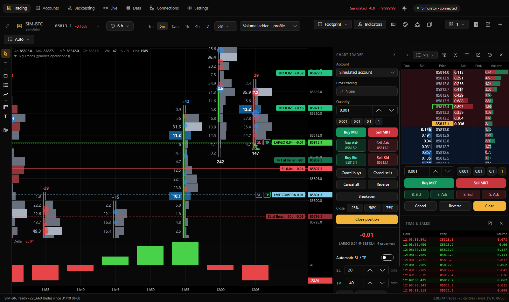

[← Back to documentation](README.md)

# Trading

Orders can be entered from the **Trading** page through Chart Trader, the depth-of-market (DOM) ladder, the chart, or assigned keyboard shortcuts. Each chart has a selected trading account; the default is the **Simulated account**.

## Select an account

Each chart remembers its account choice in the Chart Trader **Account** selector. Available accounts depend on the chart instrument and your [connections](conexiones.md).

| Chart/data source | Trading accounts |
|---|---|
| Any supported chart | Simulated account |
| Binance Futures / Spot | Matching Binance testnet or explicitly enabled real account |
| Rithmic futures | Connected Rithmic practice or real accounts |
| CME futures via Rithmic or Tradovate | Compatible Tradovate demo or real accounts |

Rithmic accounts become selectable once the order-session connection completes. The interface marks real-money accounts with an orange **REAL ACCOUNT** warning.

## Chart Trader

> Historical upstream screenshot: labels may still appear in Spanish. Refer to the [current English UI snapshot workflow](https://github.com/dhamnaik-lab/trading-hub/actions/workflows/english-ui-snapshots.yml) for isolated screenshots; these do not validate live order routing.

Chart Trader can appear within an individual chart or at the top of the right-side panel. The individual-chart panel applies only to that chart. The right-side panel follows the active chart and can be detached into a separate window.

| Control | Meaning |
|---|---|
| Account | Choose where orders will be routed |
| Cross trading | Route an order to a different instrument |
| Quantity | Choose a trading size, with quick presets such as 1, 2, 5, and 10 for whole-contract instruments |
| Buy MKT / Sell MKT | Place a market order |
| Buy Ask / Sell Ask | Place a limit order at the displayed ask |
| Buy Bid / Sell Bid | Place a limit order at the displayed bid |
| Cancel buys / Cancel sells | Cancel working orders on one side |
| Cancel all / Reverse | Cancel all working orders or reverse the current position |
| Breakeven | Move the protective stop to entry |
| Close 25% / 50% / 75% | Close part of a position at market and adjust associated exit orders |
| Close position | Flatten the whole position and cancel related orders |
| Position / P&L | Display quantity, side, average entry, and open/day results |
| Automatic SL / TP | Enable stop-loss and take-profit templates |

The price and position display is beneath the buttons so changing market data does not move order controls while you are using them.

## Order types

| Order type | Entry methods | Simulator fill model |
|---|---|---|
| Market | MKT buttons, Close, Reverse, partial exits | Best available bid or ask in the book, or last trade price when no book is available |
| Limit | Bid/Ask buttons, DOM price row, chart context menu | Fills after price trades through the limit or enough volume trades at the limit to clear the modeled queue |
| Stop | DOM/chart context actions beyond the current price | Triggers when the stop price trades and then executes as market |

Stop-loss and profit-target orders are intended to reduce an existing position, not reverse it. Confirm actual broker behavior and exchange order support before real-money use.

## Trading in the DOM

| Interaction | Action |
|---|---|
| Click a Bid / Buy Orders price row | Buy limit at that level, or buy stop if at/above the ask |
| Click an Ask / Sell Orders price row | Sell limit at that level, or sell stop if at/below the bid |
| Right-click or Alt/Option-click a price | Cancel working orders at that price |
| Drag an existing order | Modify its price |
| Scroll or click recenter | Move ladder view or return to market |

The DOM uses the active chart's selected quantity and account. Enabling **Double-click to trade** in DOM settings prevents a single click from submitting a new order; cancellation remains a separate action. The DOM help icon summarizes the controls.

The execution toolbar below the DOM includes size presets, market and Bid/Ask entries, Cancel, Reverse, and Close. It operates the active chart.

## Trading from the chart

- **Right-click at a price:** Offers suitable buy/sell limit and stop entries according to the current trading price, plus cancellation controls.
- **Drag an order line:** Request a price modification.
- **Right-click an existing order:** Cancel it, configure a profit target's close percentage, move a stop to breakeven, or attach a stop/target template to a pending entry order.
- **Right-click with an open position:** Actions can include closing half, closing all, moving the stop to entry, and applying stop/target templates.

These interactions can send orders immediately on practice accounts. Check the selected trading account before clicking.

## Stops and targets

The Chart Trader **Automatic SL / TP** section stores a per-instrument template:

1. Enable **Automatic SL / TP**.
2. Set the stop-loss distance in ticks.
3. Set one or more take-profit distances in ticks. You can configure up to three partial exits, each with an allocated percentage.
4. **Breakeven at TP1**, enabled by default, moves the stop to entry after the first target fills.

When enabled, stops and targets are associated with a new filled position using OCO-style management. For pending limit or stop entries, the exits are attached for placement once the entry fills. Increasing or reducing the position updates exit quantities as supported.

**Apply to position** replaces an existing position's stop and targets with the current template. You can also drag SL/TP controls or position lines to create or adjust exits on the chart.

Be aware that stops may slip or fail to fill during volatile or disconnected markets. Verify order state at the broker.

## Cross trading

Cross trading allows a chart instrument to differ from the execution instrument—for example, analyzing ES while placing orders in MES. In Chart Trader select **Cross trading**, search for the execution symbol, and choose it. Selecting **None** returns execution to the chart instrument.

The orders, stops, and targets use the selected execution instrument's exact prices. The app warns when the chart and execution instruments have different price scales.

**Critical:** ES and MES have different contract multipliers. Cross trading does not automatically guarantee correct risk exposure. Confirm instrument, contract multiplier, quantity, tick size, and prices before executing.

## Trading shortcuts

Under **Settings → Keyboard shortcuts → Trading**, you can assign actions for market buy/sell, limit buy at bid, limit sell at ask, flatten, reverse, cancel all, partial exits, breakeven, stop/target templates, and quantity presets.

**All trading shortcuts are unassigned by default.** Hotkeys apply to the active chart and normally do not trigger while typing in a text field unless they use modifiers or a function key.

## Accounts page

**Accounts** (Ctrl+5 on Windows or ⌘5 on macOS) displays the selected account's balances, positions, orders, fills, trades, and statistics.

Main summary cards include balance, daily result, open P&L, realized result, cumulative simulated P&L, available buying power for broker accounts, and active orders.

| Tab | Contents |
|---|---|
| Positions | Contract, side, quantity, average price, open and realized P&L, Close |
| Orders | Working and completed orders with state and Cancel |
| Fills | Individual executions with timestamp, symbol, side, quantity, price, commission |
| Trades | Closed entries/exits with holding duration and result |
| Statistics | Equity curve, net result, win rate, profit factor, maximum drawdown, expectancy, streaks, and long/short breakdowns |

The selected simulator balance and history persist across application restarts. **Reset simulated account** restores the starting balance and creates a fresh history; existing history is retained separately. Reset requires no open simulated orders or positions.

## Safety

- **Simulated by default:** Live-order permissions for broker connections are disabled until enabled manually. See [Real and practice accounts](conexiones.md#real-and-practice-accounts).
- **Practice orders can be immediate:** Simulated, testnet, and demo orders generally do not require additional order confirmation.
- **Real-account confirmation:** With default settings, the application asks before submitting manual real-account orders and certain order amendments, closes, reversals, cancellations, and stop changes. Binance and Rithmic provide per-connection controls. Trading Hub also has a global **Settings → Trading → Confirm live orders** option. Tradovate real orders require confirmation under the documented app behavior.
- **Maximum order quantity:** Where configured, real orders above the connection's maximum are rejected. Zero may mean unlimited—never assume zero is a safe limit.
- **Live strategy limits:** Automatic strategies support daily-loss and maximum-drawdown thresholds. **Stop all** in Live stops strategies, cancels orders, and requests position exits according to the implementation.
- **Visible account warnings:** Real accounts are marked as real in the account selector and Chart Trader.

**Important:** Order confirmation, stop management, and broker connectivity are not guarantees of risk control. This guide documents intended application behavior; verify it with your broker and a practice environment before using real funds. Backtests and simulated fills do not predict future returns.
