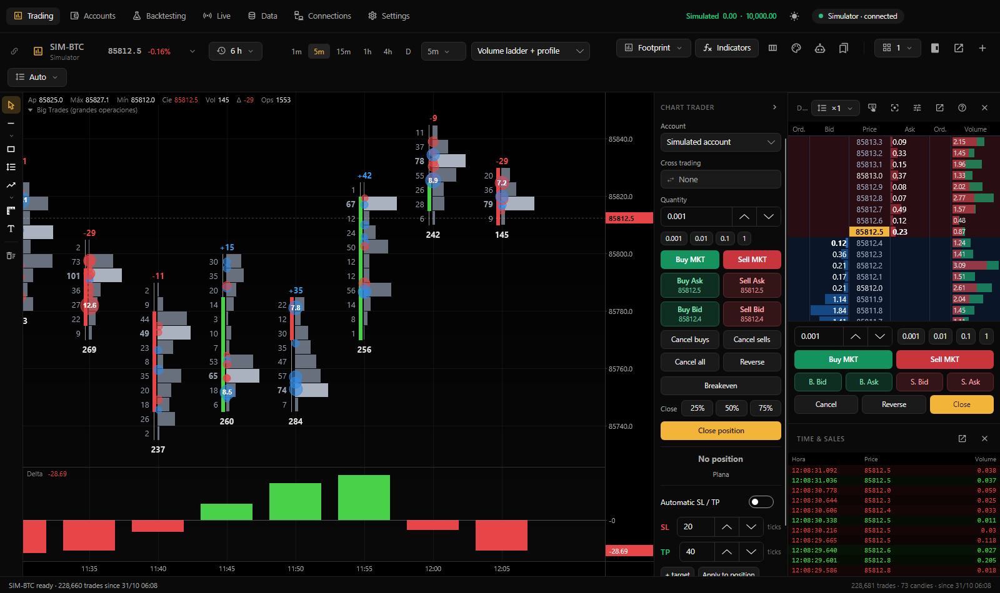

[← Back to documentation](README.md)

# Getting started

This guide introduces the main Trading Hub window and its primary features. If you have not installed the application, start with [Installation](instalacion.md).

> Screenshots were inherited from the original project and may still show Spanish labels. The English fork's main navigation now uses **Trading**, **Accounts**, **Backtesting**, **Live**, **Data**, **Connections**, and **Settings**. Some deeper screens are still being localized.

## First launch

On first launch, Trading Hub opens the **Trading** page with a simulated `SIM-BTC` chart on a five-minute period, using a footprint display and Big Trades/Delta indicators. The **Simulator** market is available without an internet connection.

The starting account is **simulated**. Trading with real money requires deliberately configuring and enabling a supported real-account connection in [Connections](conexiones.md).

Initial providers are described by the original application as:

| Provider | Initial state | Purpose |
|---|---|---|
| Simulator | Enabled | Simulated SIM-BTC, SIM-ETH, SIM-ES, and SIM-NQ |
| Binance Futures | Enabled | Public crypto futures market data |
| Binance Spot | Enabled | Public crypto spot market data |
| Bybit | Enabled | Public USDT perpetual-futures market data |
| Rithmic | Disabled | CME futures, requiring your credentials |

Data access and the ability to submit orders are separate capabilities. Some providers are data-only.

## Main window

### Navigation

On macOS, navigation is integrated into the title bar. Windows uses the corresponding desktop title/navigation area. Use **Ctrl** for the Windows command modifier and **⌘** for macOS:

| Section | Command shortcut | Purpose |
|---|---|---|
| Trading | 1 | Charts, DOM, time and sales, Chart Trader |
| Accounts | 5 | Balances, positions, orders, fills, trades, statistics |
| Backtesting | 2 | C# strategies, testing, optimization, Claude assistant |
| Live | 7 | Running strategies, portfolios, Stop All |
| Data | 3 | Saved history, downloads, imports, Databento, replay |
| Connections | 4 | Market-data and broker connections |
| Settings | , | Theme, chart time zone, hotkeys, sleep, directories |

The keyboard shortcuts above use the OS command modifier (for example `Ctrl+1` on Windows or `⌘1` on Mac).

At narrower window widths, navigation may collapse to icons; hover to see labels.

### Top bar controls

- **Simulated P&L and balance:** Displays current-day result and simulator balance. Click to open **Accounts**.
- **Sun/moon icon:** Switches between dark and light mode.
- **Connection status:** Shows the active chart's data-provider connection. Click to **Reconnect now** or open **Connections**.

| Status | Meaning |
|---|---|
| Connected | Market data is arriving. |
| Connecting / Reconnecting (attempt N) | Establishing or recovering a connection. |
| No data for N minutes | Connection may remain active while no new trades arrive. |
| Market closed; opens day/time | Session is closed; this does not necessarily indicate a connection failure. |
| Error / Disconnected | Check the connection configuration. |

Trading Hub attempts to reconnect and recover missing data when a suspended computer wakes or a connection recovers.

### Status bar

The bottom status area shows recent notifications such as order submissions, history loads, price alerts, and errors. Hover for longer messages. The chart summary displays trade count, candle count, and earliest loaded time, or a loading percentage while history is being fetched.

## Trading page

1. **Chart toolbar:** Instrument selector, data history, periods, chart style, indicators, footprint, colors, strategies, templates, layouts, panels, detachable windows, and new tabs. See [Charts](graficos.md).
2. **Tabs and layouts:** Tabs can contain multiple charts. Tabs can be cloned or rearranged with supported layout controls.
3. **Chart canvas:** Drawing tools appear on the left; the chart's own Chart Trader can appear on the right.
4. **Right panel:** Can contain Chart Trader, DOM, and time and sales; adjust panel dividers or detach sections as needed.
5. **Replay toolbar:** Appears when the active chart uses recorded replay data. See [Data](datos.md#replay).

For order-entry details and risk controls see [Trading](operar.md).

## Simulated account

- The documented initial balance is 10,000 in the account's display currency, adjustable in **Accounts**.
- The simulator can be used with the built-in simulated markets or supported real-time market data.
- Market orders use the best available bid/ask under the simulator's fill model; limit orders model price crossings and order queue volume; stops trigger when the simulated price condition is reached.
- Simulator balance and fills are persisted. Closing the app does not reset the account. **Reset simulated account** clears its current history and restores its starting balance.

Simulator results may differ from actual executions because of liquidity, market impact, fees, latency, and exchange-specific rules.

## Open a chart

1. In **Trading**, click the instrument selector at the start of the chart toolbar, or use `Ctrl+K` / `⌘K`.
2. Choose the connection/provider or **Favorites**.
3. Search for an instrument such as BTC, ETH, or NQ. Use the arrow keys to navigate results.
4. Press Enter or double-click to open the selected instrument. Use the OS command modifier plus Enter to open it in a new tab where supported.
5. Click the star next to a symbol to make it a favorite.

Recent history is loaded according to the provider's settings. Use the history control to request older data. Create a tab with `Ctrl+T` / `⌘T` or **+**. Close the current chart with `Ctrl+W` / `⌘W`, subject to the app keeping a usable chart/tab available.

To connect real-world data sources or supported broker accounts, see [Connections](conexiones.md).

## Application menus

The macOS menu bar, and equivalent app commands on Windows, use these names:

| Menu | Functions |
|---|---|
| **File** | New chart, Close chart, Find instrument, Save workspace, Open data folder |
| **Chart** | Indicators, Edit footprint, Auto scale, Go to latest price, Layout, Detach chart, Panels, Configure DOM |
| **Go** | Open any of the seven primary sections |
| **Code** | Indicator editor, Open indicators folder, Recompile indicators, Strategy backtesting, Live strategies, Open strategies folder |

The workspace layout—charts, tabs, and panels—is also saved and restored by the application.

## System tray and menu bar

Trading Hub can remain active after the main window is closed: in the **Windows system tray** or the **macOS menu bar**, depending on your Settings and platform.

The menu can show current connection status, running live strategies, and open positions, with actions such as **View live panel**, **Open Trading Hub**, and **Quit Trading Hub**.

**Closing a window is not necessarily quitting the program.** This matters when live strategies are running. On macOS use `⌘Q` or **Quit Trading Hub**; on Windows use the application's exit command or its supported `Alt+F4` exit flow. Check [Settings](ajustes.md#live-strategies) for auto-resume and tray behavior.

## Keyboard shortcuts

In **Settings → Keyboard shortcuts** you can customize actions affecting the active chart, including:

| Typical shortcut | Action |
|---|---|
| Alt/Option+1 through Alt/Option+6 | Select 1m, 5m, 15m, 1h, 4h, or daily period |
| Alt/Option+H | Draw a horizontal line |
| Alt/Option+T | Show/hide Chart Trader |
| Ctrl+Tab / Ctrl+Shift+Tab | Next/previous tab |

Availability may depend on OS shortcut handling and focused controls. Use the Settings screen to confirm actual assignments. Click a binding to change it; Esc cancels and Backspace clears it. **Restore defaults** resets the bindings.

**Trading shortcuts are intentionally unassigned by default** (buy, sell, close, reverse, cancel, partial exit, breakeven, etc.). See [Trading safety](operar.md#safety).

In chart mode, Esc cancels selection or drawing, Delete removes selected drawings, arrow keys pan when supported, and +/− adjust chart scale.

## Settings worth checking

- **General:** Dark/light theme, chart time zone, alerts.
- **Trading:** Confirm live orders—review before using a real account.
- **Live strategies:** Tray/menu-bar operation, automatic resume, and mini/micro selection.
- **Prevent sleep:** Keep the computer awake during critical work; be cautious with closed laptop lids.
- **Data:** Record incoming market data and open the data directories.

## Next steps

- [Connections](conexiones.md) — Add markets and data providers.
- [Charts](graficos.md) — Footprint, indicators, drawings, and templates.
- [Trading](operar.md) — Chart Trader, DOM, orders, brackets, and accounts.
- [Data](datos.md) — Historical files, downloads, Databento, and replay.
